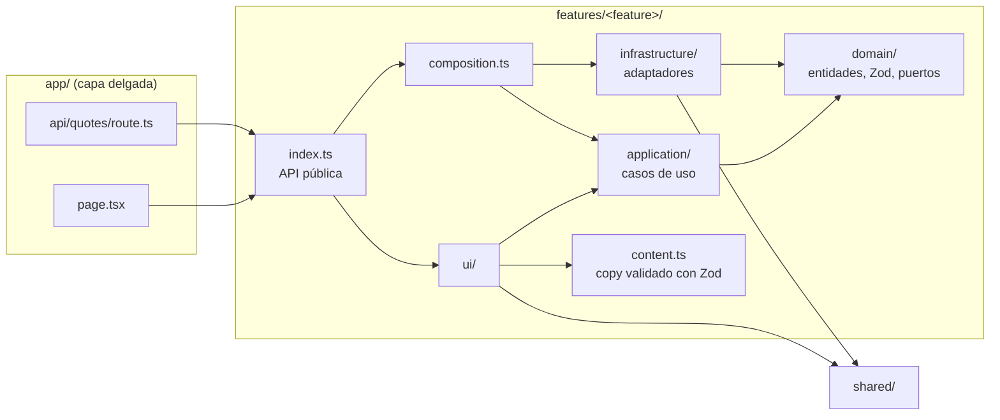

# Código Dinero — landing

Landing de **Código Dinero** (academia de trading, partner oficial de EC Markets) en Next.js 16. Es una réplica pixel perfect de `reference/`: 0,000% de diferencia por sección en 1440, 1024, 768 y 390 px.

- Stack: Next.js 16.4 (App Router, Turbopack, React Compiler, Cache Components), React 19.3, TypeScript 6 estricto, Tailwind CSS 4, Zod 4, GSAP, Remotion, TanStack Query, next-safe-action.
- La home está 100% prerenderizada. Lo dinámico son islas cliente (ticker, FAQ, carrusel, menú, formulario, video) y la ruta `/api/quotes`.
- Pendientes de contenido y de integración: [`docs/PENDIENTES.md`](docs/PENDIENTES.md).

## Cómo correrlo

Todo corre en Docker. No hace falta instalar Node ni navegadores en el host. Desde la carpeta del repo (en WSL):

```bash
docker compose build app                          # imagen de desarrollo y test (una vez)
docker compose run --rm app pnpm install          # dependencias

docker compose up -d dev                          # next dev en http://localhost:3000
docker compose run --rm app pnpm build            # build de producción
```

| Comando (`docker compose run --rm app …`) | Qué hace                                                                                                          |
| ----------------------------------------- | ----------------------------------------------------------------------------------------------------------------- |
| `pnpm dev` / `pnpm build` / `pnpm start`  | Desarrollo, build y servidor de producción                                                                        |
| `pnpm lint`                               | ESLint, incluidas las reglas de arquitectura (`eslint-plugin-boundaries`)                                         |
| `pnpm format` / `pnpm format:check`       | Prettier                                                                                                          |
| `pnpm typecheck`                          | `next typegen` + `tsc --noEmit`                                                                                   |
| `pnpm test` / `pnpm test:coverage`        | Vitest: unitarios, componentes y contract tests (cobertura ≥ 90% en `domain/` y `application/`)                   |
| `pnpm test:e2e`                           | Playwright contra el build de producción: smoke, SEO, formulario, menú, axe y CSP                                 |
| `pnpm test:visual`                        | Regresión visual por sección contra `reference/`. Tabla en consola y diffs en `test-results/visual/`              |
| `pnpm remotion:studio`                    | Remotion Studio en http://localhost:3002 (usar el servicio `dev`: `docker compose exec dev pnpm remotion:studio`) |
| `pnpm remotion:render`                    | Renderiza el MP4 a `public/video/promo-codigo-dinero.mp4`                                                         |

Variables de entorno (validadas con Zod en `src/shared/config/env.ts`; ver `.env.example`):

| Variable               | Por defecto             | Uso                                                         |
| ---------------------- | ----------------------- | ----------------------------------------------------------- |
| `NEXT_PUBLIC_SITE_URL` | `http://localhost:3000` | `metadataBase`, canonical, sitemap y JSON-LD                |
| `SITE_ENV`             | `development`           | Solo `production` es indexable; el resto sale con `noindex` |
| `QUOTES_PROVIDER`      | `simulated`             | Adaptador de cotizaciones del ticker                        |

Los hooks de Git (Husky) corren en el host y delegan en el contenedor: `lint-staged` en el pre-commit y `commitlint` (Conventional Commits) en el commit-msg. CI (`.github/workflows/ci.yml`) corre lint, formato, tipos, tests con cobertura, build, e2e y la regresión visual, en la misma imagen.

## Arquitectura

```
src/
  app/        # Enrutamiento y composición: page, layout, api/quotes, metadata (OG, icon, sitemap, robots, manifest)
  features/   # Una carpeta por sección
  shared/     # ui/ (primitivas), lib/, config/ (site, env, photos), seo/ (metadata, JSON-LD)
```



Reglas, verificadas por ESLint (`eslint.config.mjs`), que fallan en CI:

- `ui → application → domain`; `infrastructure → domain`. `domain` y `application` solo pueden importar `zod`.
- Entre features, solo a través del `index.ts`. Los imports profundos están prohibidos.
- `shared` nunca importa de `features`. `app/` solo compone features.

Las features con lógica:

- **market-ticker**: puerto `QuoteSource` → `SimulatedQuoteSource` (random walk de la referencia), caso de uso `getTickerQuotes`, ruta `/api/quotes` validada con Zod y polling con TanStack Query cada 3 s. Mientras la fuente sea simulada, la etiqueta "Simulado" queda visible.
- **lead-capture**: esquema Zod compartido entre cliente y servidor, Server Action (next-safe-action), caso de uso `captureLead` con honeypot y puerto `RateLimiter`, y `ConsoleLeadRepository`.

Cada puerto tiene un contract test (`*.contract.ts`) que corre contra cada uno de sus adaptadores.

## Cómo cambiar el proveedor de cotizaciones

1. Crear el adaptador en `src/features/market-ticker/infrastructure/`, implementando `QuoteSource` (`isSimulated: false` y `getQuotes(symbols)`, que devuelve `{ symbol, price, open, decimals }`).
2. Correrle el contract test: `quoteSourceContract("MiProveedor", () => new MiProveedor(...))` en un `*.test.ts`.
3. Agregar el valor a `QUOTES_PROVIDER` en `src/shared/config/env.ts` (y sus credenciales como variables de servidor).
4. Registrarlo en el mapa `quoteSources` de `src/features/market-ticker/composition.ts`.
5. Si llama a un servicio externo desde el navegador, sumarlo a `connect-src` en la CSP de `next.config.ts`. Si lo llama desde el servidor (lo recomendado, vía `/api/quotes`), no hace falta.

Con una fuente real, "Simulado" desaparece solo (`simulated: false`). Hay ideas de proveedores en `docs/PENDIENTES.md`.

## Cómo reemplazar las fotos de clientes

Hay tres espacios: hero, mentor (sección "¿Qué es?") y CTA final. Sin foto, se muestra la silueta con la pastilla "Foto", igual que en la referencia.

1. Exportar la foto como **PNG con fondo transparente**, recortada a la persona (proporción aproximada 300 × 340; mínimo 620 px de ancho).
2. Copiarla a `src/shared/config/photos/` (por ejemplo `hero.png`).
3. En `src/shared/config/photos.ts`, importarla y asignarla:

   ```ts
   import heroPhoto from "./photos/hero.png";

   export const photos = {
     hero: { src: heroPhoto, alt: "Nombre Apellido, mentor de Código Dinero" },
     mentor: null,
     cta: null,
   };
   ```

`next/image` genera los tamaños y reserva el espacio, así que no hay saltos de layout. Las reseñas aceptan un `avatar` opcional en `src/features/testimonials/content.ts`.

## Cómo editar los textos

Cada sección tiene su `content.ts` en `src/features/<sección>/content.ts`, validado con Zod al cargar el módulo: un texto mal formado rompe el build en lugar de la página.

| Sección                                   | Archivo                                  |
| ----------------------------------------- | ---------------------------------------- |
| Menú, logo, links, redes, partner         | `src/shared/config/site.ts`              |
| Hero                                      | `src/features/hero/content.ts`           |
| Cifras y sello de partner                 | `src/features/broker-partner/content.ts` |
| ¿Qué es?                                  | `src/features/about/content.ts`          |
| Formación, clases y links de YouTube      | `src/features/training/content.ts`       |
| Reseñas                                   | `src/features/testimonials/content.ts`   |
| Cintas de temas                           | `src/features/topics-ribbon/content.ts`  |
| FAQ (también genera el JSON-LD `FAQPage`) | `src/features/faq/content.ts`            |
| Formulario de correo                      | `src/features/lead-capture/content.ts`   |
| Footer y aviso de riesgo                  | `src/features/site-footer/content.ts`    |

Los marcadores (`[PRECIO]`, `[PLATAFORMA]`, `[Nombre del alumno]`, …) se reemplazan ahí mismo. La lista completa está en `docs/PENDIENTES.md`. Después de editar, `pnpm test:visual` muestra qué secciones cambiaron respecto de la referencia (es esperable que cambien si cambia el texto).
