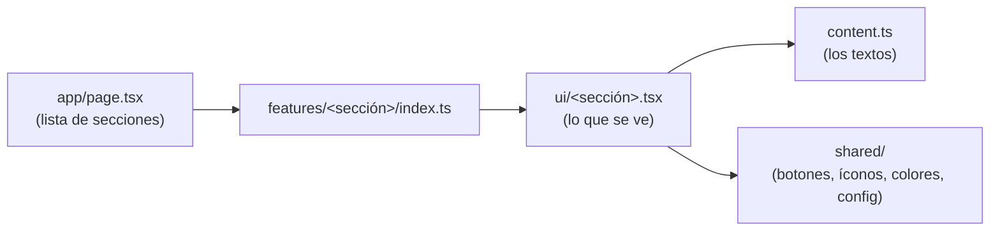

# Código Dinero — landing

Landing de **Código Dinero** (formación en trading, partner oficial de EC Markets) en Next.js 16. Es una réplica pixel perfect de `reference/` (página "Principal v4" del lienzo de diseño), con la regresión visual por sección en 1440, 1024, 768 y 390 px.

- Stack: Next.js 16.4 (App Router, Turbopack, React Compiler, Cache Components), React 19.3, TypeScript 6 estricto, Tailwind CSS 4, Zod 4, GSAP y los widgets oficiales de TradingView.
- La home está 100% prerenderizada. Lo dinámico son islas cliente (menú, FAQ, pestañas de mercado, animaciones y widgets de TradingView). Compras y solicitudes abren WhatsApp; los registros van al link Partner/IB.
- Pendientes de contenido y de integración: [`docs/PENDIENTES.md`](docs/PENDIENTES.md).

## Cómo correrlo

Todo corre en Docker. No hace falta instalar Node ni navegadores en el host. Desde la carpeta del repo (en WSL):

```bash
docker compose build app                          # imagen de desarrollo y test (una vez)
docker compose run --rm app pnpm install          # dependencias

docker compose up -d dev                          # next dev en http://localhost:3000
docker compose run --rm app pnpm build            # build de producción
```

| Comando (`docker compose run --rm app …`) | Qué hace                                                                                             |
| ----------------------------------------- | ---------------------------------------------------------------------------------------------------- |
| `pnpm dev` / `pnpm build` / `pnpm start`  | Desarrollo, build y servidor de producción                                                           |
| `pnpm lint`                               | ESLint, incluidas las reglas de arquitectura (`eslint-plugin-boundaries`)                            |
| `pnpm format` / `pnpm format:check`       | Prettier                                                                                             |
| `pnpm typecheck`                          | `next typegen` + `tsc --noEmit`                                                                      |
| `pnpm test` / `pnpm test:coverage`        | Vitest: unitarios y de componentes (cobertura ≥ 90% en los archivos con lógica)                      |
| `pnpm test:e2e`                           | Playwright contra el build de producción: smoke, SEO, links, menú, axe y CSP                         |
| `pnpm test:visual`                        | Regresión visual por sección contra `reference/`. Tabla en consola y diffs en `test-results/visual/` |

Variables de entorno (validadas con Zod en `src/shared/config/env.ts`; ver `.env.example`):

| Variable               | Por defecto                                                                   | Uso                                                                   |
| ---------------------- | ----------------------------------------------------------------------------- | --------------------------------------------------------------------- |
| `NEXT_PUBLIC_SITE_URL` | En Vercel, `https://` + dominio de producción; si no, `http://localhost:3000` | `metadataBase`, canonical, sitemap, JSON-LD y URLs de las imágenes OG |
| `SITE_ENV`             | En Vercel, `VERCEL_ENV`; si no, `development`                                 | Solo `production` es indexable; el resto sale con `noindex`           |

**Deploy en Vercel**: no hace falta configurar variables. Producción toma el dominio del proyecto y queda indexable; los previews salen con `noindex` y su canonical apunta a producción. Si se usa un dominio propio, conviene definir `NEXT_PUBLIC_SITE_URL` con ese dominio (Vercel toma como "producción" el dominio que marques como principal).

**Íconos y Open Graph**: el favicon (`src/app/favicon.ico`), `icon.png`, `apple-icon.png` y los íconos del manifest (`public/icons/`) salen del emblema del logo con `docker compose run --rm app pnpm icons` (`scripts/generate-icons.mjs`), que también genera la foto en PNG para la imagen OG. La imagen OG (`src/app/opengraph-image.tsx`, reutilizada por `twitter-image.tsx`) se arma en el build con los textos del hero y del partner.

Los hooks de Git (Husky) corren en el host y delegan en el contenedor: `lint-staged` en el pre-commit y `commitlint` (Conventional Commits) en el commit-msg. CI (`.github/workflows/ci.yml`) corre lint, formato, tipos, tests con cobertura, build, e2e y la regresión visual, en la misma imagen.

## Arquitectura

```
src/
  app/        # Enrutamiento y composición: page, layout, metadata (OG, icon, sitemap, robots, manifest)
  features/   # Una carpeta por sección
  shared/     # ui/ (primitivas, widgets de TradingView), lib/, config/ (site, links, markets, env, photos), seo/
```

**La página se arma en `src/app/page.tsx`**: es la lista de secciones en orden (`<SiteHeader />`, `<Hero />`, `<About />`, …). Cada sección es una carpeta en `src/features/`:



Las secciones son `content.ts` (textos) + `ui/<sección>.tsx` (diseño) + `index.ts`. Es solo front: no hay backend, CMS ni formularios. La poca lógica vive en archivos planos:

| Archivo                                  | Qué hace                                                                                    |
| ---------------------------------------- | ------------------------------------------------------------------------------------------- |
| `src/shared/config/links.ts`             | Todos los destinos externos, el número de WhatsApp y `whatsappUrl()` (con los mensajes)     |
| `src/shared/config/markets.ts`           | Los símbolos de TradingView (cinta del header, mini gráficos y pestañas de mercado)         |
| `src/shared/ui/tradingview-widget.tsx`   | Un componente por widget oficial de TradingView; carga el script al acercarse a la pantalla |
| `src/features/about/ui/candle-chart.tsx` | Las velas de "¿Qué es?", que crecen en cascada al entrar en pantalla (GSAP)                 |

Reglas, verificadas por ESLint (`eslint.config.mjs`), que fallan en CI:

- Una sección usa otra solo a través de su `index.ts`. Dentro de una sección, los archivos se importan libremente.
- `shared` nunca importa de `features`. `app/` solo compone secciones.

## Cómo cambiar links, WhatsApp y cotizaciones

- **Links y WhatsApp**: `src/shared/config/links.ts`. El número (`WHATSAPP_NUMBER`) y el link de registro Partner/IB (`links.partnerRegistration`) se cambian en un solo lugar para todos los botones. Cada botón lleva su `data-link` (por ejemplo `whatsapp-libro` o `partner-ib-registro`).
- **Cotizaciones**: los widgets de TradingView traen los datos en vivo. Para cambiar o sumar instrumentos, editar `src/shared/config/markets.ts` (símbolo con el prefijo del mercado, por ejemplo `OANDA:XAUUSD`) y las pestañas en `src/features/market-overview/content.ts`.

## Cómo reemplazar las fotos

Las fotos de Ángel están en `src/shared/config/photos/` y se asignan en `src/shared/config/photos.ts`: recortes sin fondo (WebP transparente) para el hero y el cierre, y fotos con fondo para "Quién soy", los eventos y el tutorial. Para cambiar una, copiar el archivo nuevo a esa carpeta e importarlo en `photos.ts`. `next/image` genera los tamaños y reserva el espacio, así que no hay saltos de layout. Si se cambia la foto del hero, correr `pnpm icons` para regenerar la de la imagen Open Graph.

## Cómo editar los textos

Cada sección tiene su `content.ts` en `src/features/<sección>/content.ts`, validado con Zod al cargar el módulo: un texto mal formado rompe el build en lugar de la página.

| Sección                                   | Archivo                                     |
| ----------------------------------------- | ------------------------------------------- |
| Menú, logo, redes, partner                | `src/shared/config/site.ts`                 |
| Links externos y mensajes de WhatsApp     | `src/shared/config/links.ts`                |
| Hero                                      | `src/features/hero/content.ts`              |
| Cifras y sello de partner                 | `src/features/broker-partner/content.ts`    |
| ¿Qué es?                                  | `src/features/about/content.ts`             |
| Quién soy                                 | `src/features/mentor-profile/content.ts`    |
| Recursos                                  | `src/features/training/content.ts`          |
| Libro y biblioteca                        | `src/features/library/content.ts`           |
| Indicador Institucional Premium           | `src/features/premium-indicator/content.ts` |
| Cotizaciones en tiempo real               | `src/features/market-overview/content.ts`   |
| Cintas de temas                           | `src/features/topics-ribbon/content.ts`     |
| FAQ (también genera el JSON-LD `FAQPage`) | `src/features/faq/content.ts`               |
| Contacto                                  | `src/features/contact/content.ts`           |
| Footer y aviso de riesgo                  | `src/features/site-footer/content.ts`       |

Los marcadores (`[PRECIO]`, `[PLATAFORMA]`, `[Título del recurso]`, …) se reemplazan ahí mismo. La lista completa está en `docs/PENDIENTES.md`. Después de editar, `pnpm test:visual` muestra qué secciones cambiaron respecto de la referencia (es esperable que cambien si cambia el texto).

## Referencia de diseño

`reference/index.html` es el render de la página "Principal v4" del lienzo de diseño (`reference/design-source.dc.html`). Si el diseño cambia, reemplazar ese archivo, copiar a `reference/` las imágenes nuevas, mapearlas en `scripts/build-reference.mjs` y correr `docker compose run --rm app node scripts/build-reference.mjs`.
